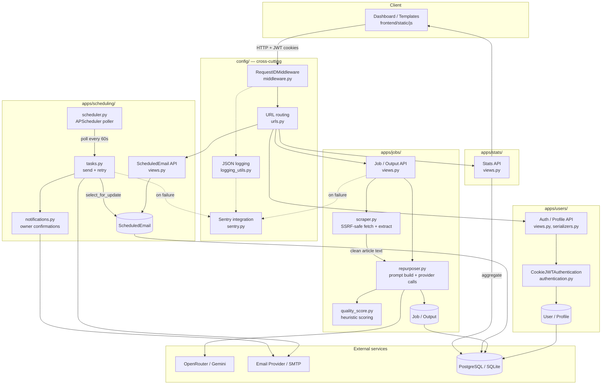
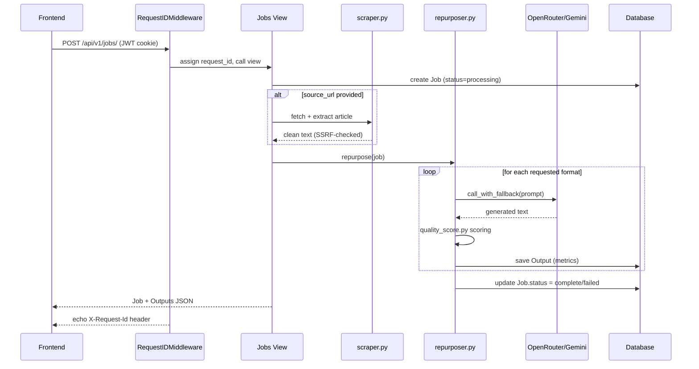

# ContentFlow AI

<p align="center">
  
  
  
</p>

ContentFlow AI is a Django + DRF application for transforming long-form content into multiple platform-optimized outputs such as tweet threads, LinkedIn posts, email newsletters, and TL;DR summaries. It supports blog content input either as raw text or scraped from a public URL, then runs AI generation through OpenRouter and Gemini-backed model flows.

The project combines a user auth layer, content generation jobs, scheduled email delivery, analytics, and a full API surface for a frontend dashboard experience.

## Table of contents

- [Overview](#overview)
- [Architecture](#architecture)
- [Project structure](#project-structure)
- [Core features](#core-features)
- [Technology stack](#technology-stack)
- [Data model](#data-model)
- [AI generation workflow](#ai-generation-workflow)
- [Scheduled email system](#scheduled-email-system)
- [URL scraping and safety](#url-scraping-and-safety)
- [Authentication and authorization](#authentication-and-authorization)
- [API endpoints](#api-endpoints)
- [Environment setup](#environment-setup)
- [Local development](#local-development)
- [Testing](#testing)
- [Production considerations](#production-considerations)
- [Security notes](#security-notes)

---

## Overview

ContentFlow is built around a simple content workflow:

1. A user signs up or logs in.
2. They create a content generation job with text or a source URL.
3. The scraper extracts readable article content from the URL when applicable.
4. The backend calls an AI model to repurpose that content into target formats.
5. Generated outputs are stored with metrics like tokens, latency, quality, and ratings.
6. Users can schedule email-format outputs to be delivered to recipients at a chosen time.
7. Users can review historical jobs and view summary statistics in the dashboard.

---

## Architecture

### System flow



### Request lifecycle (synchronous job creation)



### Layer responsibilities

- `config/`: global Django settings, URL routing, middleware, logging, Sentry integration
- `apps/users/`: custom user model, account management, profile, avatar handling, cookie-based JWT auth
- `apps/jobs/`: job lifecycle, scraping, AI generation, output persistence
- `apps/stats/`: model and summary analytics, scheduling statistics
- `apps/scheduling/`: scheduled email delivery with APScheduler, confirmation notifications
- `frontend/`: Django templates and static UI assets; public pages use a glassmorphism design (Bootstrap 5.3.2 + custom CSS tokens)

### Service-oriented design

- `apps/jobs/services/scraper.py`: SSRF-safe URL fetch with DNS resolution validation
- `apps/jobs/services/repurposer.py`: prompt building, provider calls with retry logic, output persistence
- `apps/jobs/services/quality_score.py`: heuristic 0-100 quality scoring per output format
- `apps/scheduling/tasks.py`: scheduled email dispatch with retry and concurrency safety
- `apps/scheduling/services/notifications.py`: account-owner confirmation emails
- `config/middleware.py`: request ID correlation middleware
- `config/logging_utils.py`: structured JSON logging for production
- `config/sentry.py`: Sentry error tracking integration

---

## Project structure

```text
ContentFlow/
├── backend/
│   ├── apps/
│   │   ├── jobs/
│   │   │   ├── migrations/
│   │   │   ├── services/
│   │   │   │   ├── repurposer.py
│   │   │   │   ├── scraper.py
│   │   │   │   └── quality_score.py
│   │   │   ├── admin.py
│   │   │   ├── apps.py
│   │   │   ├── models.py
│   │   │   ├── serializers.py
│   │   │   ├── throttles.py
│   │   │   ├── urls.py
│   │   │   └── views.py
│   │   ├── scheduling/
│   │   │   ├── migrations/
│   │   │   ├── services/
│   │   │   │   └── notifications.py
│   │   │   ├── admin.py
│   │   │   ├── apps.py
│   │   │   ├── models.py
│   │   │   ├── scheduler.py
│   │   │   ├── serializers.py
│   │   │   ├── tasks.py
│   │   │   ├── throttles.py
│   │   │   ├── urls.py
│   │   │   └── views.py
│   │   ├── stats/
│   │   │   ├── models.py
│   │   │   ├── serializers.py
│   │   │   ├── urls.py
│   │   │   └── views.py
│   │   └── users/
│   │       ├── migrations/
│   │       ├── admin.py
│   │       ├── apps.py
│   │       ├── authentication.py
│   │       ├── models.py
│   │       ├── serializers.py
│   │       ├── urls.py
│   │       └── views.py
│   ├── config/
│   │   ├── settings.py
│   │   ├── urls.py
│   │   ├── views.py
│   │   ├── middleware.py
│   │   ├── logging_utils.py
│   │   ├── sentry.py
│   │   ├── wsgi.py
│   │   └── asgi.py
│   ├── media/
│   │   └── avatars/
│   ├── manage.py
│   ├── requirements.txt
│   └── README.md
├── frontend/
│   ├── static/
│   │   ├── css/
│   │   └── js/
│   │       ├── common.js
│   │       ├── login.js
│   │       ├── register.js
│   │       ├── dashboard.js
│   │       ├── history.js
│   │       ├── job.js
│   │       ├── settings.js
│   │       ├── stats.js
│   │       └── scroll-effects.js
│   └── templates/
│       ├── base.html
│       ├── nav.html
│       ├── index.html
│       ├── login.html
│       ├── register.html
│       ├── dashboard.html
│       ├── history.html
│       ├── job.html
│       └── stats.html
├── PRD/
└── .gitignore
```

---

## Core features

- Custom email-based user model with UUID primary keys
- Cookie-based JWT authentication with httpOnly cookies, token rotation, and blacklisting
- Job creation through raw content or URL ingestion
- AI-powered repurposing into four content formats (tweet thread, LinkedIn, email, TL;DR)
- Provider fallback: OpenRouter primary with Gemini fallback, retry with exponential backoff
- Heuristic quality scoring per output format
- Scheduled email delivery with APScheduler (in-process background scheduler)
- Account-owner confirmation notifications on email send/failure
- Dashboard statistics for user performance and per-model analytics
- Rate limiting for auth, scraping, job creation, and email scheduling
- Avatar upload with content-type validation and size limits
- Request ID correlation across logs
- Structured JSON logging in production
- Sentry error tracking integration
- Health check endpoint
- API documentation via Swagger and Redoc

---

## Technology stack

### Backend

- Python 3.x
- Django 6.0
- Django REST Framework
- SimpleJWT (cookie-based)
- django-cors-headers
- django-environ
- drf-spectacular
- BeautifulSoup4 + lxml
- Requests
- Pillow
- APScheduler (in-process scheduled email dispatch)
- google-genai (Gemini SDK)
- OpenRouter API
- Sentry SDK

### Frontend

- Django templates (base.html, nav.html, 7 page templates)
- Bootstrap 5.3.2 (CDN) + custom CSS design system (`frontend/static/css/styles.css`)
- Per-page JavaScript modules under `frontend/static/js/`
- Glassmorphism UI on public pages (landing, login, register) with `backdrop-filter` glass cards
- Scroll-reveal animations (`scroll-effects.js`) and parallax hero (`parallax.js`)

### Persistence

- PostgreSQL (production) or SQLite (development) via `DATABASE_URL`
- Local media storage under `backend/media/`

---

## Data model

### User and Profile

- `User`: custom model with email as `USERNAME_FIELD`, UUID primary key, fields: `email`, `full_name`, `created_at`, `is_active`, `is_staff`
- `Profile`: auto-created one-to-one with User via post_save signal. Fields: `avatar` (ImageField, JPEG/PNG/WebP, 2MB limit), `theme_color` (hex, default `#8A2BE2`), `default_model`, `updated_at`

### Job

- `id`: UUID primary key
- `user`: owning user (foreign key)
- `content`: source article or content text
- `formats`: JSON list of requested output formats
- `source_url`: optional URL source
- `model`: AI model selected for the job
- `provider_used`: provider (OpenRouter/Gemini)
- `status`: `processing`, `complete`, or `failed`
- `word_count`: auto-computed on save
- `created_at`

### Output

- `id`: UUID primary key
- `job`: foreign key to parent Job
- `format`: `tweet_thread`, `linkedin`, `email`, or `tldr`
- `text`: generated content
- `character_count`: auto-computed on save
- `latency_ms`, `tokens_generated`, `tokens_per_second`
- `quality_score`: heuristic 0-100 score
- `user_rating`: optional 1-5 star rating
- `provider`: `openrouter` or `gemini`
- `created_at`

### ScheduledEmail

- `id`: UUID primary key
- `output`: foreign key to an email-format Output
- `user`: denormalized foreign key to User
- `recipients`: JSON list of email addresses (max 25)
- `subject`: email subject line
- `edited_content`: editable email body (defaults to output text)
- `status`: `draft`, `scheduled`, `sent`, `failed`, or `cancelled`
- `scheduled_for`: future datetime (max 90 days out)
- `sent_at`: actual send timestamp
- `error_message`: failure reason
- `attempt_count`: retry counter (max 3 attempts)
- `created_at`, `updated_at`
- Database index on `(status, scheduled_for)` for efficient polling

---

## AI generation workflow

The main generation logic lives in `apps/jobs/services/repurposer.py`.

### Flow

1. User creates a job with content or a source URL.
2. The view triggers `repurpose(job)`.
3. The repurposer loops through all selected formats.
4. For each format it calls `call_with_fallback(...)`.
5. The system prompt is built per format.
6. The model response is cleaned, scored via `quality_score.py`, and saved as an Output record.
7. Job status is updated to `complete` or `failed`.

### Provider support

- OpenRouter as the primary API path
- Gemini as a fallback with 11 available free models
- Retry logic with exponential backoff (3 attempts)
- `get_available_free_model()` fetches live model lists from both providers

### Supported formats

- `tweet_thread`: numbered X/Twitter-style thread
- `linkedin`: professional post with hook and CTA
- `email`: newsletter email with subject line
- `tldr`: concise 3-5 bullet-point summary

### Quality scoring

`quality_score.py` provides a heuristic 0-100 score per format without external API calls:

- **Tweet thread**: checks numbered markers, 3+ tweets, 280 char limit per tweet
- **LinkedIn**: checks 150-300 word range, paragraph structure
- **Email**: checks subject line presence, 200-400 word range
- **TL;DR**: checks bullet characters, 3-5 bullets, single sentences

---

## Scheduled email system

The scheduling app (`apps/scheduling/`) enables users to schedule email-format outputs for delivery to recipients at a future time.

### How it works

1. User creates a scheduled email via `POST /api/v1/scheduled-emails/` with an email-format output, recipients, subject, and scheduled time.
2. APScheduler runs an in-process background scheduler (`scheduler.py`) that polls every 60 seconds.
3. `tasks.py` finds due rows and sends each via Django's `EmailMessage` with `select_for_update` for concurrency safety.
4. Failed sends retry up to 3 times before marking as failed.
5. After send or final failure, a confirmation email is sent to the account owner (not the recipients).

### Email configuration

Email delivery uses Django's email backend, configured via environment variables. Defaults to the console backend for local development; switch to SMTP for real delivery:

```env
EMAIL_BACKEND=django.core.mail.backends.smtp.EmailBackend
EMAIL_HOST=live.smtp.mailtrap.io
EMAIL_PORT=587
EMAIL_HOST_USER=api
EMAIL_HOST_PASSWORD=your-smtp-password
EMAIL_USE_TLS=True
DEFAULT_FROM_EMAIL=ContentFlow AI <noreply@contentflow.ai>
```

---

## URL scraping and safety

The scraper (`apps/jobs/services/scraper.py`) is intentionally defensive.

### Safety rules

- Blocks non-HTTP(S) schemes
- Blocks localhost and internal network addresses
- Blocks metadata endpoints and private IP ranges
- Resolves DNS and validates all resolved IPs to prevent DNS rebinding attacks
- Disables HTTP redirect following to prevent redirect-based SSRF
- Blocks known internal domains from `SCRAPER_BLOCKED_DOMAINS`

### Extraction pipeline

- Fetches page HTML with a browser-like User-Agent
- Strips scripts, styles, nav, footer, forms, and other noise tags
- Prefers semantic `<article>` or `<main>` content roots
- Normalizes whitespace and truncates to 50,000 characters

---

## Authentication and authorization

Authentication uses cookie-based JWT with httpOnly cookies.

### How it works

- `CookieJWTAuthentication` (`apps/users/authentication.py`) reads JWT from httpOnly cookies, falling back to the Authorization header
- Access tokens last 1 hour, refresh tokens last 7 days
- Refresh tokens are rotated and blacklisted after use
- Cookies are marked `Secure` (production), `HttpOnly`, and `SameSite=Strict`
- Logout blacklists the refresh token

### Public endpoints

- `POST /api/v1/auth/register/`
- `POST /api/v1/auth/login/` (sets JWT cookies)
- `POST /api/v1/auth/token/refresh/`

### Authenticated endpoints

- `POST /api/v1/auth/logout/` (blacklists refresh token)
- `GET /api/v1/auth/me/`
- `GET/PATCH /api/v1/auth/profile/`
- `POST/DELETE /api/v1/auth/profile/avatar/`
- `DELETE /api/v1/auth/account/` (requires password confirmation)

---

## API endpoints

All API routes are under `/api/v1/`.

### Authentication

| Method | Endpoint | Description |
|--------|----------|-------------|
| POST | `/api/v1/auth/register/` | Register a new user |
| POST | `/api/v1/auth/login/` | Login and receive JWT cookies |
| POST | `/api/v1/auth/token/refresh/` | Refresh access token |
| POST | `/api/v1/auth/logout/` | Logout and blacklist refresh token |
| GET | `/api/v1/auth/me/` | Current user details |
| GET/PATCH | `/api/v1/auth/profile/` | View/update profile |
| POST | `/api/v1/auth/profile/avatar/` | Upload avatar |
| DELETE | `/api/v1/auth/profile/avatar/` | Remove avatar |
| DELETE | `/api/v1/auth/account/` | Delete account (requires password) |

### Jobs and outputs

| Method | Endpoint | Description |
|--------|----------|-------------|
| GET | `/api/v1/jobs/` | List current user's jobs |
| POST | `/api/v1/jobs/` | Create a job and generate outputs |
| GET | `/api/v1/jobs/<uuid>/` | Retrieve a specific job with outputs |
| DELETE | `/api/v1/jobs/<uuid>/` | Delete a job and its outputs |
| GET | `/api/v1/jobs/<uuid>/status/` | Poll job status and progress |
| GET | `/api/v1/outputs/` | List outputs (filter by `?format=` and `?model=`) |
| PATCH | `/api/v1/outputs/<uuid>/rate/` | Rate an output (1-5 stars) |
| POST | `/api/v1/scrape/` | Fetch article text from a URL |
| GET | `/api/v1/models/available/` | List available free model IDs |

### Scheduled emails

| Method | Endpoint | Description |
|--------|----------|-------------|
| GET | `/api/v1/scheduled-emails/` | List scheduled emails (filter by `?status=`, `?output_id=`) |
| POST | `/api/v1/scheduled-emails/` | Schedule an email-format output for delivery |
| PATCH | `/api/v1/scheduled-emails/<uuid>/` | Edit a draft/scheduled email |
| POST | `/api/v1/scheduled-emails/<uuid>/cancel/` | Cancel a scheduled email |

### Statistics

| Method | Endpoint | Description |
|--------|----------|-------------|
| GET | `/api/v1/stats/models/` | Per-model performance stats |
| GET | `/api/v1/stats/summary/` | User summary stats for dashboard |
| GET | `/api/v1/stats/scheduling/` | Scheduled email status counts and daily activity |

### Infrastructure

| Method | Endpoint | Description |
|--------|----------|-------------|
| GET | `/health/` | Database health check |
| GET | `/api/schema/` | OpenAPI schema |
| GET | `/api/docs/` | Swagger UI |
| GET | `/api/redoc/` | ReDoc |

### Frontend pages

| Route | Description |
|-------|-------------|
| `/` | Landing page |
| `/login/` | Login page |
| `/register/` | Registration page |
| `/logout/` | Logout redirect |
| `/dashboard/` | Main dashboard |
| `/settings/`, `/profile/` | User settings |
| `/history/` | Job history |
| `/job/` | Job detail |
| `/stats/` | Analytics page |

---

## Rate limiting

| Scope | Rate | Applies to |
|-------|------|------------|
| `anon` | 20/minute | Unauthenticated requests |
| `user` | 60/minute | Authenticated requests |
| `auth` | 5/hour | Login/register |
| `account_action` | 30/hour | Account changes |
| `jobs_create_burst` | 3/minute | Job creation |
| `jobs_create_daily` | 15/day | Job creation |
| `scrape` | 5/minute | URL scraping |
| `scheduled_email_create` | 20/hour | Email scheduling |

---

## Environment setup

The project loads configuration via `django-environ` from a `.env` file in `backend/`.

### Required variables

```env
DJANGO_SECRET_KEY=your-secret-key
JWT_SIGNING_KEY=your-jwt-signing-key
DEBUG=False
DATABASE_URL=sqlite:///db.sqlite3
ALLOWED_HOSTS=localhost,127.0.0.1
CORS_ALLOWED_ORIGINS=http://localhost:9000
OPENROUTER_API_KEY=your_openrouter_key
GEMINI_API_KEY=your_gemini_api_key
GEMINI_FALLBACK_MODEL=gemini-3.1-flash-lite
SENTRY_DSN=
SENTRY_TRACES_SAMPLE_RATE=0.1
SENTRY_SEND_DEFAULT_PII=False
SCRAPER_BLOCKED_DOMAINS=localhost,127.0.0.1,metadata.google.internal
```

### Email configuration (optional)

```env
EMAIL_BACKEND=django.core.mail.backends.smtp.EmailBackend
EMAIL_HOST=live.smtp.mailtrap.io
EMAIL_PORT=587
EMAIL_HOST_USER=api
EMAIL_HOST_PASSWORD=your-smtp-password
EMAIL_USE_TLS=True
DEFAULT_FROM_EMAIL=ContentFlow AI <noreply@contentflow.ai>
```

The default email backend is `console` (prints to stdout). Switch to SMTP for real delivery.

---

## Local development

### 1) Create a virtual environment

```bash
cd backend
python -m venv venv
```

On Windows PowerShell:

```powershell
cd backend
python -m venv venv
.\venv\Scripts\Activate.ps1
```

### 2) Install dependencies

```bash
pip install -r requirements.txt
```

### 3) Configure environment

Create a `.env` file in `backend/` using `.env.example` as a template.

### 4) Apply migrations

```bash
python manage.py migrate
```

### 5) Run the server

```bash
python manage.py runserver 0.0.0.0:8000
```

### 6) Open the app

- App: `http://localhost:8000/`
- Swagger docs: `http://localhost:8000/api/docs/`
- ReDoc: `http://localhost:8000/api/redoc/`

---

## Testing

```bash
pytest
pytest apps/jobs/tests/                                    # single app
pytest apps/jobs/tests/test_x.py::TestClass::test_method   # single test
```

---

## Production considerations

- Set `DEBUG=False` and generate a cryptographically random `DJANGO_SECRET_KEY` and `JWT_SIGNING_KEY`
- Use PostgreSQL or another production database
- Configure `CLOUDINARY_URL` in the environment for persistent avatar storage.
  The avatar field uploads to Cloudinary and Neon stores the Cloudinary asset ID.
- Store all secrets in environment variables or a secrets manager
- Configure `ALLOWED_HOSTS` and `CORS_ALLOWED_ORIGINS` for production domains
- Replace synchronous AI generation with Celery or another async job system
- Replace the in-process APScheduler with a production task queue
- Use a reverse proxy (nginx) with HTTPS termination
- Pin dependency versions with upper bounds or use a lockfile
- Monitor AI provider failures and latency with Sentry

---

## Security notes

- Cookie-based JWT authentication with httpOnly, Secure, and SameSite=Strict cookies
- JWT refresh token rotation and blacklisting
- Custom user model with email-based authentication and password validation
- SSRF prevention in the scraper: blocks private IPs, resolves DNS to prevent rebinding, disables redirects
- User-scoped queries throughout — no cross-user data access
- Request throttling for public and sensitive endpoints
- Avatar upload validation: content-type check, 2MB size limit, JPEG/PNG/WebP only
- Content length limit (50,000 chars) on job creation
- Scheduled email recipient validation (max 25 email addresses, 90-day scheduling horizon)
- Request ID correlation via `X-Request-Id` header for audit trails
- Production security headers: HSTS, secure cookies, X-Content-Type-Options, X-XSS-Protection
- `SECURE_SSL_REDIRECT` enabled in production
- Sentry integration with configurable PII opt-in
- Media file paths namespaced per user ID

---

## Monitoring and observability

- **Sentry**: Django and logging integrations, configurable DSN and traces sample rate
- **Structured logging**: console format in development, JSON format in production with request_id, job_id, and format fields
- **Request ID**: `RequestIDMiddleware` generates/adopts UUID request IDs, echoed as `X-Request-Id` response header
- **Health check**: `GET /health/` checks database connectivity

---

## Contributing

When extending the project:

- Keep business logic in service modules, not in views
- Validate all input in serializers before reaching the model layer or external APIs
- Keep user-specific data access scoped by `request.user`
- Respect existing throttle scopes when adding endpoints
- Prefer defensive error handling around external AI and scraper calls
- Add tests for validation, auth, and provider edge cases

---

## Useful commands

```bash
pip install -r requirements.txt       # install dependencies
python manage.py migrate              # run migrations
python manage.py runserver 0.0.0.0:8000  # start local server
python manage.py createsuperuser      # create admin user
pytest                                # run tests
```
